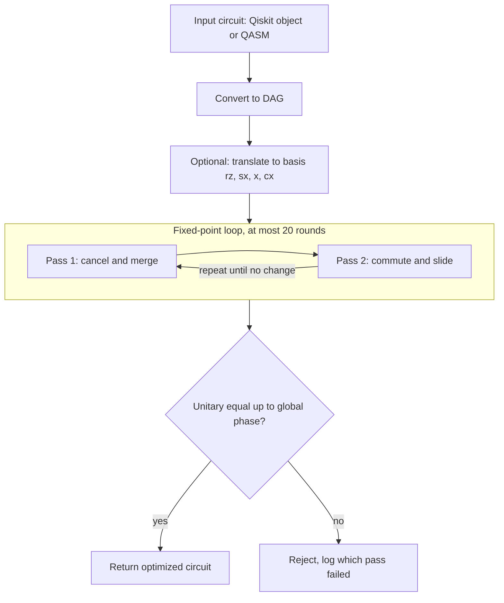

<p align="center">
  
" alt="Quarte: verified gate reduction for noisy quantum circuits" width="100%">
</p>

<p align="center">
  
  
  
  
</p>

**Quarte** is a classical, explainable optimizer for quantum circuits. It rewrites a circuit into a shorter one, proves the result computes the same unitary up to a global phase, and measures the outcome against Qiskit's transpiler, in noisy simulation and on IBM hardware.

It is a transparent research prototype. It matches Qiskit's optimization level 1 on two-qubit gate count across our benchmark set and is beaten by levels 2 and 3 on structured circuits. The [claims ledger](#8-claims-ledger-what-is-and-is-not-supported) states exactly what the evidence supports.

---

## Contents

1. [Motivation](#1-motivation) · 2. [Problem formulation](#2-problem-formulation) · 3. [Method](#3-method) · 4. [Verification](#4-verification) · 5. [Experimental protocol](#5-experimental-protocol) · 6. [Results](#6-results) · 7. [Hardware run](#7-hardware-run) · 8. [Claims ledger](#8-claims-ledger-what-is-and-is-not-supported) · 9. [Threats to validity](#9-threats-to-validity) · 10. [Quickstart](#10-quickstart) · 11. [Repository map](#11-repository-map) · 12. [Reproducibility](#12-reproducibility) · 13. [Security](#13-security) · 14. [Related work](#14-related-work) · 15. [FAQ](#15-faq)

---

## 1. Motivation

Near-term (NISQ) processors have no error correction. Each gate fails with some small probability, two-qubit gates fail most, and idle time adds decoherence. The probability that a circuit returns the intended answer therefore falls with gate count and depth. Circuits produced by people or libraries often contain structure that can be removed without changing what they compute: a gate followed by its inverse, or rotations that could be one.

Optimal compilation is a hard combinatorial problem, and production compilers rely on heuristics. We study a deliberately narrow, inspectable slice of that space: local rewrite rules with a correctness proof per rule and a mechanical check on every output.

<p align="center">
<sub><i>Suggested figure:</i> three-panel schematic (where the problem begins, the problem, what we solve). See <code>docs/figures.md</code>.</sub>
</p>

## 2. Problem formulation

Let a circuit $C$ over a gate set $\mathcal{G}$ implement the unitary $U(C)$. We seek $C'$ with

$$U(C') = e^{i\varphi}\,U(C)\quad\text{for some }\varphi\in\mathbb{R},$$

minimizing a cost that prioritizes the two-qubit gate count $n_{2q}$, then total gate count $n$, then depth $d$. The global phase $e^{i\varphi}$ is physically unobservable, so equivalence is taken modulo phase. Measurements, barriers and classical control are never rewritten across.

## 3. Method

The circuit is held as a directed acyclic graph (DAG): nodes are gates, edges are qubit wires. Two gates are **adjacent** only if nothing else touches any of their qubits between them. This strict, wire-by-wire test is the main guard against illegal rewrites; Qiskit's `quantum_successors` alone is not enough, because it can report two gates as neighbours when a third intervenes on a different wire.



### 3.1 Pass 1: cancellation and merging

| Rule | Identity used |
|---|---|
| Inverse pairs: H·H, X·X, Y·Y, Z·Z, CX·CX (same control and target), CZ·CZ, SWAP·SWAP | $U U^{\dagger} = I$ |
| Adjoint pairs: S·S†, T·T†, SX·SX† (either order) | $U U^{\dagger} = I$ |
| SX·SX → X | $\sqrt{X}\sqrt{X} = X$ |
| Same-axis rotations: $R_\sigma(a)R_\sigma(b) \to R_\sigma(a+b)$ for RZ, RX, RY, P | $e^{-ia\sigma/2}e^{-ib\sigma/2}=e^{-i(a+b)\sigma/2}$ |
| Rotation by a multiple of $2\pi$ removed (tolerance $10^{-9}$) | equals $\pm I$, i.e. identity up to global phase |

CX(0,1) followed by CX(1,0) is **not** an inverse pair and is never cancelled. Symbolic parameters are skipped. The pass repeats to a fixed point, because one removal can expose another.

### 3.2 Pass 2: commutation with rollback

A gate may slide past a neighbour only if the two commute. Rules are deliberately conservative; when unsure the answer is "does not commute".

| Gate A | Gate B | Commute? | Reason |
|---|---|---|---|
| any | any, disjoint qubits | yes | act on separate tensor factors |
| diagonal (Z, S, S†, T, T†, RZ, P) | CX, on its **control** | yes | CX = \|0⟩⟨0\|⊗I + \|1⟩⟨1\|⊗X, and diagonal gates commute with the projectors |
| X-type (X, RX, SX, SX†) | CX, on its **target** | yes | commutes with X |
| diagonal | CZ, either qubit | yes | all diagonal |
| CX, CX sharing only a control, or only a target | | yes | |
| diagonal on CX **target**; X-type on CX **control** | | **no** | changes the phase or the control condition |
| CX(a,b), CX(b,c); CX(a,b), CX(b,a) | | **no** | target of one is control of the other |

Lookahead is bounded (10 gates). A slide is committed only if it enables a cancellation or merge, so gate count strictly drops; otherwise the DAG is restored, and a test asserts the restored circuit is instruction-for-instruction identical, not just equivalent.

**Worked example.** `rz(0.4) q0; cx q0,q1; rz(0.6) q0` has three gates and Pass 1 cannot reduce it. RZ commutes with the CX control, so Pass 2 slides it adjacent to the second RZ, Pass 1 merges them to `rz(1.0)`, and the result has two gates.

### 3.3 Correctness argument

Each rewrite replaces a subcircuit by one with an equal unitary (up to phase) acting on the same qubits, so the composition of rewrites preserves $U(C)$ up to phase. We do not rely on this argument alone; section 4 checks it mechanically.

## 4. Verification

`optimizer/equivalence.py` strips measurements and barriers, builds both unitaries, and tests equality up to global phase with `Operator.equiv`. The cost grows as $4^{n}$ in memory, so the check is limited to **10 qubits**. The pipeline never returns an unchecked circuit silently: on failure it reports `equivalent=False` and names the pass.

Tests cover: identical circuits, an injected extra gate (must fail), global-phase-only differences, qubit-count mismatch, measurement handling, every rule with a positive and a negative case, the CX chain and reversed-CX cases, bit-for-bit rollback, and fixed-seed random-circuit fuzzing with a broad gate mix.

## 5. Experimental protocol

- **Benchmarks (17):** GHZ, QFT, QFT followed by its inverse (known answer), Bell, a small Grover search, ripple-carry adders, and eight seeded random circuits with deliberate redundancy.
- **Variants (7):** original, Qiskit levels 0 to 3, `ours` (`optimize(..., translate_to_basis=True)`), and `ours_highlevel` (passes run before basis translation).
- **Fairness rule:** every variant is compiled to the same basis `{rz, sx, x, cx}`; hardware variants share one physical layout, backend, shot count and transpiler settings.
- **Noisy simulation:** Qiskit Aer with a fake IBM backend's noise model, three seeds, circuits of at most 7 qubits with a known ideal distribution.
- **Output:** 17 × 7 = 119 rows in `results/results.csv`.

## 6. Results

<!-- RESULTS:START -->
Wins, ties and losses of `ours` against Qiskit, by circuit count (17 circuits). A tie means exactly equal counts.

| Metric | vs L0 | vs L1 | vs L2 | vs L3 |
|---|---|---|---|---|
| Two-qubit gates | 6 W / 11 T / 0 L | 0 W / 17 T / 0 L | 0 W / 13 T / 4 L | 0 W / 13 T / 4 L |
| Total gates | 14 / 3 / 0 | 6 / 5 / 6 | 0 / 8 / 9 | 0 / 8 / 9 |
| Depth | 14 / 3 / 0 | 6 / 5 / 6 | 2 / 7 / 8 | 2 / 7 / 8 |
<!-- RESULTS:END -->

Reading guide:

- Beating level 0 is the weakest claim, since level 0 does almost no optimization.
- **Tie with level 1 on two-qubit gates in 17 of 17 circuits** is the central result.
- Levels 2 and 3 win on four circuits, mainly arithmetic and Grover, where they re-synthesize blocks of gates. Our local rewrite rules do not.
- Gate-count reductions of roughly one third to two thirds appear only on the synthetic redundant circuits and are not a general claim.

## 7. Hardware run

One job on `ibm_fez` (Heron r2, native `cz`): QFT followed by inverse QFT on three qubits, answer `101`, four variants, 2,000 shots each, identical physical qubits.

<!-- RESULTS:START -->
| Variant | Total gates | CZ gates | Depth | Success probability |
|---|---|---|---|---|
| original | 182 | 24 | 123 | 0.8980 ± 0.0068 |
| ours | 131 | 18 | 91 | 0.9065 ± 0.0065 |
| Qiskit L1 | 130 | 18 | 91 | 0.9125 ± 0.0063 |
| Qiskit L3 | 2 | 0 | 1 | 0.9805 ± 0.0031 |
<!-- RESULTS:END -->

Errors are one binomial standard error and capture shot noise only, not drift between runs. The gain of `ours` over `original` is +0.0085 against a combined standard error of about 0.009, so it is **within noise**. Qiskit L3 wins because QFT followed by inverse QFT is the identity and level 3 detects it, which makes this circuit a weak probe of optimizer quality. Further runs, GHZ and a redundant random circuit are in `docs/hardware_run.md` as they are added.

## 8. Claims ledger: what is and is not supported

| Claim | Status |
|---|---|
| Optimized circuits equal the originals up to global phase | **Supported** (checked on every optimized circuit, up to 10 qubits) |
| Matches Qiskit L1 on two-qubit gate count | **Supported** (17 of 17 benchmarks) |
| Fewer gates and lower depth than the unoptimized circuit on hardware | **Supported** (24 → 18 CZ, depth 123 → 91, one run) |
| Higher success probability on hardware | **Suggestive only** (within error bars) |
| Better than Qiskit L2 or L3 | **Not supported** (they win on structured circuits) |
| General reduction of 35% or more | **Not supported** (synthetic redundant sets only) |
| Simulated fidelity predicts hardware fidelity | **Not claimed** (a noise model is not a measurement) |

## 9. Threats to validity

- **Benchmark selection.** Seventeen circuits, several synthetic. Redundant random circuits favour any cancellation pass.
- **Baseline comparison.** Qiskit's levels include techniques we lack; results depend on the shared basis and seed chosen.
- **Hardware evidence.** Few runs, one device at a time, and device noise drifts between days.
- **Simulation.** A fake backend snapshot approximates a device at one moment.
- **Small seed count.** Three seeds give a rough standard deviation.
- **Scope cuts.** Routing onto a device coupling map was not implemented; equivalence checking is limited to 10 qubits.
- **AI-assisted development.** Parts of the code and documentation were drafted with AI coding assistants. Correctness rests on the tests and the equivalence checker, not on trust in generated code. <!-- TODO(authors): state the extent of AI assistance as the event rules require. -->

## 10. Quickstart

```bash
git clone https://github.com/madhu2007-offical/Quarte && cd Quarte
python -m venv .venv
source .venv/bin/activate            # Windows PowerShell: .\.venv\Scripts\Activate.ps1
pip install -r requirements.txt
pytest -q
```

```bash
uvicorn api.main:app --port 8000                    # API, Swagger at http://localhost:8000/docs
streamlit run dashboard/app.py --server.port 8501   # dashboard, works offline from saved results
```

```python
from benchmarks.generators import qft
from optimizer.pipeline import optimize

res = optimize(qft(3), translate_to_basis=True)
print(res.equivalent, res.per_pass_metrics)
```

Hardware (optional; needs your own IBM Quantum account on the free Open Plan):

```bash
python hardware/run_ibm.py --benchmark qft_then_inverse_3                  # dry run, no cloud calls
python hardware/run_ibm.py --benchmark qft_then_inverse_3 --shots 2000 \
       --repeats 3 --max-qpu-seconds 60 --submit                           # real submission
python scripts/aggregate_hardware.py
```

## 11. Repository map

| Path | Purpose |
|---|---|
| `optimizer/` | `cancellation.py` (Pass 1), `commutation.py` and `commutation_rules.py` (Pass 2), `equivalence.py`, `pipeline.py`, `base.py` (pass interface) |
| `benchmarks/` | Seeded circuit generators and exported QASM |
| `metrics/` | Gate count, two-qubit gate count, depth |
| `baselines/` | Qiskit transpile at levels 0 to 3 in the shared basis |
| `simulation/` | Noisy simulation and fidelity measures |
| `hardware/` | Dry-run and submit workflow with a QPU budget guard |
| `api/`, `dashboard/` | FastAPI service and Streamlit dashboard (read-only) |
| `scripts/` | Benchmark sweep, hardware aggregation, figures |
| `results/` | `results.csv` and saved hardware JSON |
| `tests/`, `docs/` | Test suite and long-form documentation |

## 12. Reproducibility

Dependencies are pinned in `requirements.txt`. All generators and simulations use fixed seeds. `python scripts/run_benchmarks.py` regenerates `results/results.csv`; no result number in this document is typed by hand, and the tables above are generated from the saved files (`scripts/make_readme_tables.py`).

## 13. Security

IBM credentials are read only from a saved Qiskit account or a git-ignored `.env`. They are never logged or committed. The dashboard and API cannot submit hardware jobs.

## 14. Related work

Rotation merging and gate cancellation follow the line of work on automated optimization of circuits with continuous parameters (Nam et al., arXiv:1710.07345). Heuristic lookahead routing is the subject of SABRE (Li, Ding, Xie, arXiv:1809.02573), the basis of Qiskit's `SabreSwap`, which we did not implement. TKET (Sivarajah et al., arXiv:2003.10611) is a retargetable NISQ compiler. Identifiers were collected during scoping and should be re-checked before citing.

## 15. FAQ

**How do you know a circuit is unchanged?** We compute both unitaries and compare them up to global phase. This is exact for up to 10 qubits.

**Why not just use Qiskit?** Use it. Quarte is a transparent, inspectable implementation of a subset of its techniques, with a correctness check on every output, built to study where local rewriting suffices.

**Why does Qiskit level 3 beat you on QFT followed by inverse QFT?** That circuit equals the identity, and level 3 re-synthesizes blocks until it finds that.

**Why was routing cut?** It needs a permutation-aware equivalence check and a careful evaluation, which did not fit the time. It is the first extension we would add.

**What does the hardware run show?** Fewer entangling gates and lower depth for the same computation, and a success probability that rose slightly within noise. It does not show a proven fidelity gain.

**What next?** More repeated hardware runs and circuits that cannot collapse to the identity, block resynthesis, routing, and a sampling-based equivalence check beyond 10 qubits.

---

**Authors:** <!-- TODO(authors) --> · **License:** <!-- TODO: choose a license --> · Not affiliated with or endorsed by IBM. Qiskit is used under its open-source license.
