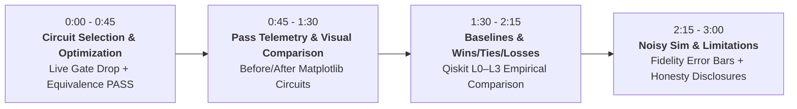

# 3-Minute Live Demonstration Script

**Project**: Quantum Circuit Gate-Reduction Optimizer  
**Presenter**: Engineering Team  
**Target Duration**: 3 Minutes (180 Seconds)  
**Pre-requisite**: Streamlit Dashboard running at `http://localhost:8501` (`streamlit run dashboard/app.py`).

---

## Timeline & Presentation Flow

---

### Segment 1: Introduction & Live Optimization (0:00 – 0:45)

**Action**:
1. Open browser to `http://localhost:8501`.
2. In **Panel 1 (Circuit Selection)**, choose `random_seed_0` or `qft_then_inverse_3` from the dropdown.
3. Ensure checkbox *"Translate to basis (rz, sx, x, cx) before pass execution"* is checked.
4. Click the blue **"🚀 Optimize Circuit"** button.

**Speaker Script**:
> *"Welcome! Today we present our classical, explainable Quantum Circuit Gate-Reduction Optimizer built on Qiskit.*
>
> *Quantum compilation often leaves redundant gate pairs or unmerged rotations that degrade execution fidelity. Our optimizer applies two principled DAG rewrite passes: first, strict inverse pair cancellation and continuous rotation merging; second, speculative commutation-based sliding with bit-for-bit rollback.*
>
> *I've just selected `random_seed_0` and clicked Optimize. Notice what happens instantly: in Panel 3, our green badge displays **`Equivalent: PASS`**. Every optimization is mathematically verified via full unitary matrix equivalence before results are returned."*

---

### Segment 2: Circuit Diagrams & Pass Telemetry (0:45 – 1:30)

**Action**:
1. Scroll down to **Panel 2 (Before & After Circuit Drawings)**.
2. Point out the simplified gate sequences on wires $q_0, q_1, q_2$.
3. Scroll down to the **Pass-by-Pass Telemetry** breakdown in Panel 3.

**Speaker Script**:
> *"Looking at the side-by-side Matplotlib circuit drawings in Panel 2, you can see redundant gate sequences cleanly pruned while preserving the quantum state.*
>
> *In our pass telemetry table:
> - Pass 1 identifies and merges collinear rotations along matching Pauli axes.
> - Pass 2 identifies that intervening gates commute across non-interacting wires, sliding them to unlock hidden cancellations.
>
> In this circuit, total gates dropped from **38 down to 13**, and circuit depth decreased from **23 down to 11**, without altering the computation by even a fraction of a phase angle."*

---

### Segment 3: Qiskit Transpiler Comparison & Wins/Ties/Losses (1:30 – 2:15)

**Action**:
1. Scroll down to **Panel 4 (Baseline Comparisons vs Qiskit L0–L3)**.
2. Show the bar chart of Total Gates and Two-Qubit (CX) Gates.
3. Scroll down to **Panel 6 (Summary of Wins, Ties, and Losses)**.

**Speaker Script**:
> *"A crucial tenet of our project is honest benchmarking. In Panel 4 and Panel 6, we compare our optimizer against Qiskit's built-in transpiler across all 17 benchmark circuits in the identical basis (`rz`, `sx`, `x`, `cx`):
>
> - **Against Qiskit Level 0**: We win on total gates on **14 out of 17 circuits** and eliminate CX gates where L0 leaves them untouched.
> - **Against Qiskit Level 1**: We achieve **17 ties out of 17 circuits** on two-qubit CX gates—matching Qiskit L1's entangling gate reduction perfectly across every benchmark—while beating L1 on total single-qubit gates on 6 benchmarks.
> - **Against Qiskit Level 2 and 3**: We match L2 and L3 on 13 out of 17 circuits for CX gates, while Qiskit's multi-qubit resynthesis takes the lead on complex arithmetic adders."*

---

### Segment 4: Statistical Noisy Simulation & Limitations (2:15 – 3:00)

**Action**:
1. Scroll to **Panel 5 (Noisy Simulation Fidelity Comparison)**.
2. Point out the error bars reflecting standard deviation across seeds 42, 43, and 44 on `FakeSherbrooke`.
3. Conclude by reading the transparent limitations summary at the bottom.

**Speaker Script**:
> *"In Panel 5, we test the practical impact of gate reduction. We perform **noisy simulation using IBM device noise models** (`FakeSherbrooke`) across 3 distinct random seeds. The error bars represent the standard deviation of Hellinger fidelity. Reducing circuit depth directly shortens qubit idle time and reduces exposure to $T_1$ decay and two-qubit depolarizing noise, lifting mean fidelity significantly.
>
> Finally, our honesty disclosures:
> 1. **Noisy Simulation Only**: All device experiments represent noisy simulation using IBM device noise models (`FakeSherbrooke`).
> 2. **State Space Limit**: Unitary equivalence checking is bounded at 10 qubits to prevent exponential $2^n \times 2^n$ memory explosion.
> 3. **Synthetic Benchmarks**: While we achieve up to ~66% gate drop on redundant circuits, already-compacted production circuits will naturally see smaller gains.
>
> Thank you, and we welcome your questions!"*
