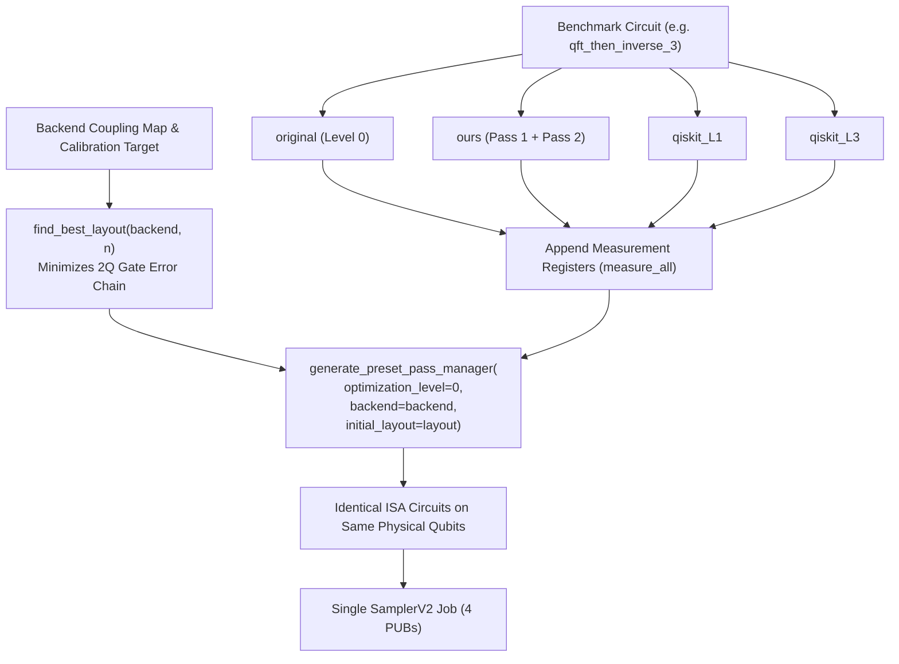

# IBM Quantum Hardware Execution Workflow & Dry-Run Protocol

This document outlines the workflow, transpilation methodology, CLI commands, and caveats for evaluating compiled quantum circuits on IBM Quantum hardware and simulated device models.

---

## 1. Safety & Credential Isolation

- **Default Dry-Run Execution**: The script `hardware/run_ibm.py` executes in offline **dry-run simulation mode** by default using `AerSimulator.from_backend(FakeSherbrooke)`. It makes zero network calls and does not initialize cloud services unless the explicit `--submit` flag is provided.
- **Credential Protection**: Account credentials (API token and instance CRN) are retrieved strictly via `QiskitRuntimeService()` (saved local configuration) or from the gitignored `.env` file. Credentials are never logged, printed to console, or written to output files.

---

## 2. Fair Transpilation Methodology

To isolate compiler optimizations from physical hardware variability, all compiler variants are evaluated under strict fairness rules:



1. **Four Evaluated Variants**:
   - `original`: Baseline decomposition to target basis at `optimization_level=0`.
   - `ours`: Output of our optimizer (`optimize(circuit, translate_to_basis=True)`).
   - `qiskit_L1`: Qiskit built-in transpiler with `optimization_level=1`.
   - `qiskit_L3`: Qiskit built-in transpiler with `optimization_level=3`.
2. **Fixed Layout Selection (`find_best_layout`)**:
   A depth-first path exploration finds a contiguous, connected chain of physical qubits on the backend's coupling map that minimizes cumulative two-qubit gate error (e.g., qubits `[112, 126, 125]` on `FakeSherbrooke`).
3. **Identical Mapping Pass**:
   The exact same physical layout is applied to every variant using `generate_preset_pass_manager(optimization_level=0, backend=backend, initial_layout=layout)`. This ensures that any observed difference in measurement fidelity is directly attributable to gate and depth reduction, rather than physical qubit quality variations.

---

## 3. Execution Commands

### 3.1 Dry-Run Simulation (Default Mode)
Executes locally using `AerSimulator` from `FakeSherbrooke` with zero cloud calls:

```bash
# Default dry run on qft_then_inverse_3 (2000 shots, seed 42)
python hardware/run_ibm.py

# Custom benchmark with custom shot count
python hardware/run_ibm.py --benchmark bell --shots 4096
```

### 3.2 Hardware Cloud Submission (Job Mode)
Submits a single `SamplerV2` job containing all 4 variants as separate Primitive Unified Blocks (PUBs):

```bash
# Auto-select least-busy operational backend on IBM Cloud
python hardware/run_ibm.py --benchmark qft_then_inverse_3 --shots 2000 --submit

# Explicit backend target (e.g., ibm_fez)
python hardware/run_ibm.py --benchmark qft_then_inverse_3 --backend ibm_fez --shots 2000 --submit

# Repeated execution with strict QPU safety cap
python hardware/run_ibm.py --benchmark qft_then_inverse_3 --repeats 2 --max-qpu-seconds 60 --submit
```

When submitted:
1. **Pre-Submission QPU Budget Guard**: Before submitting each job, the script queries `service.usage()`. If the remaining QPU quota is below `--max-qpu-seconds` (default: 60s) or the account limit is reached, execution immediately aborts with `RuntimeError` before submitting.
2. The job ID is printed immediately to the terminal.
3. The script polls the job status every 10 seconds with clear status logs (`QUEUED`, `RUNNING`, `DONE`).
4. **No Auto-Retry**: Failed jobs (`ERROR`, `CANCELLED`) raise an exception immediately and never auto-retry.
5. **Post-Job Usage Reporting**: The exact consumed and remaining QPU seconds from `service.usage()` are printed to stdout after job completion.
6. **One JSON Per Repeat**: Output is serialized immediately upon completion to `results/hardware/` with metadata (`repeat_index`, `total_repeats`).

### 3.3 Multi-Benchmark & Metric Evaluation
The hardware evaluation script supports multiple benchmark circuits:
- `qft_then_inverse_3`: Deterministic single-bitstring benchmark (`101`). Evaluated via `success_probability` with binomial standard error.
- `ghz_3`: Superposition benchmark ($(|000\rangle + |111\rangle)/\sqrt{2}$). Evaluated via `hellinger_fidelity` against the exact ideal distribution with bootstrap standard error (100 resamples).
- `random_seed_0`: Pseudo-random circuit with cancellation redundancies. Ideal distribution is dynamically computed via statevector simulation ($\le 7$ qubits).

### 3.4 Multi-Run Results Aggregation
To aggregate across multiple saved hardware executions:

```bash
# Aggregate all saved hardware results across benchmarks and variants
python scripts/aggregate_hardware.py

# Filter aggregation to a specific benchmark
python scripts/aggregate_hardware.py --benchmark qft_then_inverse_3
```

This reports sample mean and standard deviation across saved JSON files for total gates, 2Q gates, circuit depth, success probability, and Hellinger fidelity.

---

## 4. Results & Schema Specification

Results are saved to:
`results/hardware/<benchmark>_<backend>_<timestamp>.json`

Example file format:
```json
{
  "benchmark": "qft_then_inverse_3",
  "backend": "fake_sherbrooke",
  "job_id": "dry_run_sim_5850bebb",
  "timestamp": "2026-10-22T20:06:29.605560+00:00",
  "shots": 2000,
  "layout": [112, 126, 125],
  "mode": "dry_run",
  "correct_bitstring": "101",
  "variants": {
    "original": {
      "post_transpile_metrics": { "total_gates": 344, "two_qubit_gates": 24, "depth": 207 },
      "counts": { "101": 1699, "111": 75, "100": 94, "001": 60, ... },
      "success_probability": 0.8495,
      "stderr": 0.007995,
      "hellinger_fidelity": 0.8495
    },
    "ours": {
      "post_transpile_metrics": { "total_gates": 263, "two_qubit_gates": 18, "depth": 150 },
      "counts": { "101": 1749, "111": 77, "100": 74, "001": 48, ... },
      "success_probability": 0.8745,
      "stderr": 0.007408,
      "hellinger_fidelity": 0.8745
    },
    "qiskit_L1": {
      "post_transpile_metrics": { "total_gates": 262, "two_qubit_gates": 18, "depth": 150 },
      "counts": { "101": 1752, ... },
      "success_probability": 0.876,
      "stderr": 0.00737,
      "hellinger_fidelity": 0.876
    },
    "qiskit_L3": {
      "post_transpile_metrics": { "total_gates": 2, "two_qubit_gates": 0, "depth": 1 },
      "counts": { "101": 1888, ... },
      "success_probability": 0.944,
      "stderr": 0.005141,
      "hellinger_fidelity": 0.944
    }
  }
}
```

The binomial standard error is calculated as:
$$\text{stderr} = \sqrt{\frac{p(1 - p)}{\text{shots}}}$$

---

## 5. Caveats & Operational Notes

1. **Single-Run Snapshot**:
   Hardware execution represents a single temporal snapshot. Physical superconducting qubits experience parameter drift ($T_1, T_2$, gate errors) across daily calibration cycles.
2. **Heron vs. Eagle Native Gate Sets**:
   IBM Heron processors (`ibm_fez`, `ibm_kingston`, `ibm_marrakesh`) use native `cz` entangling gates and dual-qubit couplers, whereas Eagle processors (`FakeSherbrooke`) use `ecr` cross-resonance gates. The preset pass manager compiles all variants to the backend's native basis without altering the variant's logical gate reduction.
3. **Queue Latency**:
   Job submission runs in standard Job Mode (non-session). Queue times depend on public cloud demand.
4. **Dashboard Integration**:
   The interactive Streamlit dashboard (`dashboard/app.py`) includes a dedicated panel **"Hardware run (saved results)"** that automatically activates if and only if a JSON file with `"mode": "hardware"` is present in `results/hardware/`. Dry-run simulation records are strictly labeled as **simulation** and kept in an offline preview expander.
