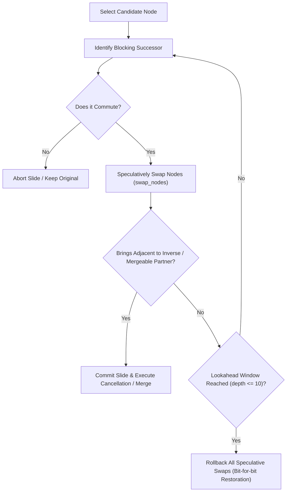

# Pass 2: Commutation-Based Rewriting (`CommutationPass`)

## 1. Overview & Motivation

`CommutationPass` unlocks gate reductions that are physically blocked by intervening gates. In quantum circuits, many adjacent gates cannot cancel because another operation sits between them. If the intervening gate commutes with the target gate, it can be mathematically slid across without altering the unitary action of the circuit.

Once slid into direct adjacency, the gates can be cancelled or merged by `CancellationPass`.

---

## 2. Commutation Rules & Mathematical Foundations

Commutation between two operators $A$ and $B$ is defined by the commutator:
$$[A, B] = A B - B A = 0 \iff A B = B A$$

When $[A, B] = 0$, swapping the order of $A$ and $B$ preserves the global unitary representation of the quantum circuit.

The commutation checker `optimizer/commutation_rules.py::commutes(node_a, node_b)` implements conservative, proven commutation relations:

| Rule # | Gate A | Gate B | Wires / Roles | Mathematical Justification |
| :---: | :--- | :--- | :--- | :--- |
| **R1** | Any unitary $U_A$ | Any unitary $U_B$ | Disjoint qubits ($\text{qargs}(A) \cap \text{qargs}(B) = \emptyset$) | Act on independent tensor factors: $U_A \otimes U_B = (U_A \otimes I)(I \otimes U_B) = (I \otimes U_B)(U_A \otimes I)$. |
| **R2** | Diagonal ($Z, S, S^\dagger, T, T^\dagger, RZ, P$) | $CX(c, t)$ | Single-qubit gate on **control** qubit $c$ only | $CX = \|0\rangle\langle 0\| \otimes I + \|1\rangle\langle 1\| \otimes X$. Any diagonal gate $D = d_0 \|0\rangle\langle 0\| + d_1 \|1\rangle\langle 1\|$ satisfies $(D \otimes I) CX = CX (D \otimes I)$. |
| **R3** | $X$-type ($X, RX, SX, SX^\dagger$) | $CX(c, t)$ | Single-qubit gate on **target** qubit $t$ only | $X$-type unitaries satisfy $[U_X, X] = 0$. Since $CX$ applies $X$ on the target, $(I \otimes U_X) CX = CX (I \otimes U_X)$. |
| **R4** | Diagonal ($Z, S, S^\dagger, T, T^\dagger, RZ, P$) | $CZ(q_1, q_2)$ | Single-qubit gate on **either** wire ($q_1$ or $q_2$) | $CZ = \text{diag}(1, 1, 1, -1)$. Single-qubit diagonal operators in the computational basis commute with all multi-qubit diagonal operators. |
| **R5** | $CX(c, t_1)$ | $CX(c, t_2)$ | Shared **control** $c$, disjoint targets ($t_1 \ne t_2$) | Both operations are conditioned on the same control register and apply independent $X$ operators to separate target registers: $[CX_{c, t_1}, CX_{c, t_2}] = 0$. |
| **R6** | $CX(c_1, t)$ | $CX(c_2, t)$ | Shared **target** $t$, disjoint controls ($c_1 \ne c_2$) | Target actions commute ($X \cdot X = I$); parity of control activations is symmetric: $[CX_{c_1, t}, CX_{c_2, t}] = 0$. |
| **R7** | Diagonal $D_1$ | Diagonal $D_2$ | Same single qubit | Diagonal matrices in the same basis commute under multiplication: $\text{diag}(u_0, u_1) \text{diag}(v_0, v_1) = \text{diag}(u_0 v_0, u_1 v_1)$. |

---

## 3. Speculative Sliding & Rollback Mechanism

Commutation alone does not reduce gate count. Reordering gates aimlessly increases circuit depth and fragments DAG structure.

`CommutationPass` therefore implements a **goal-driven, speculative sliding engine with automatic rollback**:



1. **Lookahead Window**: Explores up to 10 topological steps forward along the DAG wire.
2. **Speculative Execution**: Swaps nodes using Qiskit's native `dag.swap_nodes(n1, n2)`.
3. **Commit Condition**: A slide sequence is only committed if it immediately enables:
   - An inverse cancellation (Rule 1a, reducing gate count by 2), or
   - A rotation merge (Rule 1b, reducing gate count by 1).
4. **Bit-for-Bit Rollback**: If the lookahead window is exhausted without enabling a cancellation or merge, all speculative node swaps are reversed in reverse order, restoring the circuit DAG to its bit-for-bit identical initial instruction sequence.

---

## 4. Before / After Example

### Example: Sliding an $RZ$ Gate Through a $CX$ Control to Merge with a Downstream $RZ$
```
BEFORE:
q_0: ──[RZ(π/4)]──────[■]──────[RZ(3π/4)]──
                       │                   
q_1: ─────────────────[X]──────────────────

1. RZ(π/4) is on the control wire of CX.
2. By Rule R2, [RZ, CX(control)] = 0.
3. Speculative slide: swap RZ(π/4) past CX.
4. RZ(π/4) is now directly adjacent to RZ(3π/4).
5. Merge: RZ(π/4) + RZ(3π/4) = RZ(π). Commit!

AFTER:
q_0: ─────────────────[■]──────[RZ(π)]─────
                       │                   
q_1: ─────────────────[X]──────────────────
```

### Corresponding OpenQASM 2.0
```qasm
// Before Commutation & Optimization
OPENQASM 2.0;
include "qelib1.inc";
qreg q[2];
rz(0.7853981633974483) q[0];
cx q[0], q[1];
rz(2.356194490192345) q[0];

// After CommutationPass & CancellationPass
OPENQASM 2.0;
include "qelib1.inc";
qreg q[2];
cx q[0], q[1];
rz(3.141592653589793) q[0];
```

---

## 5. Strict Safety Invariants & Disallowed Cases

A commutation slide **must NOT** happen in any of the following cases:

1. **Diagonal Gate on $CX$ Target**:
   - $Z$-type operations on the target wire do not commute with $CX$:
     $$CX (I \otimes Z) = (Z \otimes Z) CX \ne (I \otimes Z) CX$$
     Sliding a diagonal gate across a target introduces an unintended phase-kickback onto the control wire.
2. **$X$-Type Gate on $CX$ Control**:
   - $X$-type operations on the control wire do not commute with $CX$:
     $$CX (X \otimes I) = (X \otimes X) CX \ne (X \otimes I) CX$$
     Sliding an $X$ gate across the control flips the control qubit and conditionally triggers the target.
3. **Cross-Role $CX$ Pairs**:
   - Two $CX$ gates do NOT commute if the control of one is the target of the other:
     $$CX(0, 1) \cdot CX(1, 2) \ne CX(1, 2) \cdot CX(0, 1)$$
     $$CX(0, 1) \cdot CX(1, 0) \ne CX(1, 0) \cdot CX(0, 1)$$
4. **Non-Commuting Single-Qubit Gates on the Same Wire**:
   - Distinct non-commuting Pauli axes, e.g., $[X, Z] \ne 0$, $[H, Z] \ne 0$, $[SX, RZ] \ne 0$.
5. **Barriers, Measurements, and Resets**:
   - Directives and non-unitary operations are strict boundaries; commutation across them is forbidden.
6. **Conditioned Gates and Classical Registers**:
   - Operations dependent on classical bits or dynamic control flow blocks cannot be reordered.
7. **Symbolic Parameters**:
   - Parameterized rotation angles (`is_parameterized() == True`) are not evaluated for commutation.
8. **Slides that Produce No Gate Reductions**:
   - Commutations that merely permute gates without reducing total gates or depth are rejected and rolled back.
